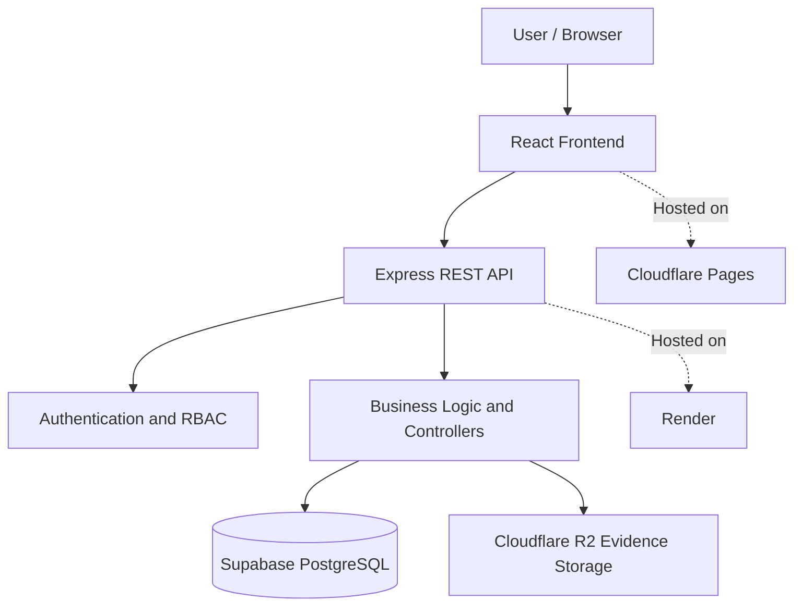

# KYC/AML Simulation Platform

A full-stack compliance technology application designed to simulate **Know Your Customer (KYC)** and **Anti-Money Laundering (AML)** workflows. The platform demonstrates how software engineering, relational databases, authentication, role-based access control, audit logging, and cloud infrastructure can support financial compliance processes.

**Live Demo:** https://kyc-aml-platform.pages.dev/  
**Backend API:** https://kyc-aml-api-5xbj.onrender.com  
**Repository:** https://github.com/Tshego-eng/kyc-aml-platform

> **Disclaimer:** This is an educational simulation and portfolio project. It is not a certified compliance solution and must not be used to make real-world financial, legal, or regulatory decisions.

## Table of Contents

- [Overview](#overview)
- [Project Objectives](#project-objectives)
- [Key Features](#key-features)
- [Technology Stack](#technology-stack)
- [System Architecture](#system-architecture)
- [User Roles and Access Control](#user-roles-and-access-control)
- [Application Modules](#application-modules)
- [Getting Started](#getting-started)
- [Environment Configuration](#environment-configuration)
- [Running the Application](#running-the-application)
- [API and Health Check](#api-and-health-check)
- [Deployment](#deployment)
- [Security Considerations](#security-considerations)
- [Future Improvements](#future-improvements)
- [Author](#author)

## Overview

Financial institutions must verify customer identities, assess risk, monitor transactions, investigate suspicious activity, and maintain records of compliance-related decisions.

The KYC/AML Simulation Platform models these workflows in a single web application. It provides a foundation for managing customer onboarding, KYC reviews, risk assessments, transaction records, AML alerts, investigation cases, supporting evidence, and audit trails.

The project was built to develop practical experience in full-stack software engineering, secure API design, database management, cloud deployment, and financial technology systems.

## Project Objectives

- Build a full-stack web application using TypeScript.
- Implement authentication and role-based authorization.
- Model compliance workflows using a relational database.
- Maintain audit records of relevant user actions.
- Support evidence management for AML investigations.
- Integrate cloud services for application hosting and object storage.
- Demonstrate the relationship between business processes, software architecture, and compliance technology.

## Key Features

### Authentication and authorization

- User registration and login.
- JSON Web Token (JWT)-based authentication.
- Password hashing.
- Role-based access control (RBAC).
- Protected frontend routes and authenticated API requests.

### Customer onboarding and KYC

- Customer record management.
- Customer onboarding status tracking.
- KYC verification workflows.
- Review and approval processes for compliance personnel.

### Risk assessment

- Risk assessment records and risk classifications.
- Risk-related workflow management.
- Support for reviewing customer risk information.

### Transaction monitoring and AML

- Transaction record management.
- AML alert management.
- AML investigation case management.
- Case assignment and status tracking.
- Supporting evidence management.

### Audit and reporting

- Audit logs for traceability.
- Dashboard summaries and operational views.
- Compliance-related reporting functionality.

*The availability and exact behavior of individual features depend on the implemented modules and current deployment.*

## Technology Stack

| Layer | Technologies |
|---|---|
| Frontend | React, TypeScript, Vite |
| Backend | Node.js, Express, TypeScript |
| Database | PostgreSQL via Supabase |
| ORM | Prisma |
| Authentication | JSON Web Tokens (JWT), bcrypt |
| API security | Helmet, CORS configuration, rate limiting |
| Object storage | Cloudflare R2 for evidence files |
| Frontend hosting | Cloudflare Pages |
| Backend hosting | Render |
| Version control | Git and GitHub |

## System Architecture

The application separates the user interface, API, database, and evidence storage into distinct components.



### Architecture overview

1. **Frontend:** React provides the user interface and sends HTTP requests to the backend API.
2. **Backend:** Express handles API routing, authentication, authorization, validation, and business logic.
3. **Database:** PostgreSQL stores application records, including users and compliance-related data.
4. **Object storage:** Cloudflare R2 stores evidence files when R2 storage is configured.
5. **Hosting:** Cloudflare Pages serves the frontend, while Render hosts the API.

## User Roles and Access Control

The application uses role-based access control to restrict access to protected operations.

The data model includes an `ANALYST` default role, and the platform includes administrative role-management functionality.

Permissions should be evaluated by the backend rather than relying solely on frontend visibility or navigation controls.

## Application Modules

| Module | Purpose |
|---|---|
| Authentication | Login, registration, and session identity |
| User management | User administration and role management |
| Customer management | Customer records and onboarding |
| KYC | Customer identity verification workflows |
| Risk assessment | Customer risk evaluation records |
| Transactions | Transaction record management |
| AML alerts | Management of alerts requiring attention |
| AML cases | Investigation workflow and case assignment |
| Evidence | Supporting files associated with investigations |
| Audit logs | Traceability of relevant application activity |
| Dashboard and reports | Operational summaries and compliance-related information |

## Getting Started

### Prerequisites

Install the following before running the project locally:

- Node.js and npm.
- Git.
- A PostgreSQL database, such as a Supabase project.
- A code editor such as Visual Studio Code.

### 1. Clone the repository

```bash
git clone https://github.com/Tshego-eng/kyc-aml-platform.git
cd kyc-aml-platform
```

### 2. Install dependencies

Install the root and backend dependencies:

```bash
npm install
npm --prefix server install --include=dev
```

Install the frontend dependencies:

```bash
npm --prefix client install
```

### 3. Configure environment variables

Create the appropriate local environment files based on the project's `.env.example` files, where provided. Configure the database connection, JWT secret, frontend API URL, and evidence storage settings.

Do not commit real credentials or secret values to GitHub.

### 4. Generate the Prisma client

From the repository root, run:

```bash
npx prisma generate
```

If the project requires a specific Prisma configuration path, use the configuration already established in the repository.

**Database warning:** Do not reset the database or apply migrations blindly. Check the existing migration status and follow the project's established database setup procedure before changing the schema.

### 5. Start the backend

From the repository root:

```bash
npm run dev
```

### 6. Start the frontend

Open a second terminal:

```bash
npm --prefix client run dev
```

Vite will display the local frontend URL in the terminal, commonly `http://localhost:5173`.

The frontend must point to the backend URL configured in `VITE_API_BASE_URL`.

## Environment Configuration

Use placeholder values in documentation. Never publish actual secrets.

### Frontend

Configure `VITE_API_BASE_URL` in the frontend's local environment file:

```dotenv
VITE_API_BASE_URL=http://localhost:5000
```

For the deployed frontend, configure the variable in Cloudflare Pages:

```dotenv
VITE_API_BASE_URL=https://kyc-aml-api-5xbj.onrender.com
```

The base URL should not include `/api` if the frontend services append the full `/api/...` endpoint paths.

### Backend

Configure the environment variables required by the backend:

```dotenv
NODE_ENV=development
PORT=5000
DATABASE_URL=your_postgresql_connection_string
JWT_SECRET=your_long_random_secret
CORS_ORIGIN=http://localhost:5173
EVIDENCE_STORAGE=local
```

When using Cloudflare R2, configure the required storage variables:

```dotenv
EVIDENCE_STORAGE=r2
R2_ACCOUNT_ID=your_cloudflare_account_id
R2_ACCESS_KEY_ID=your_r2_access_key_id
R2_SECRET_ACCESS_KEY=your_r2_secret_access_key
R2_BUCKET_NAME=your_r2_bucket_name
```

`R2_ENDPOINT` may also be required depending on the project's storage configuration. Check the backend's environment validation and storage provider implementation for the exact requirements.

For production, set `NODE_ENV=production`, use the deployed frontend's exact origin in `CORS_ORIGIN`, and store credentials in Render's environment settings. Do not use the development values in production.

## Running the Application

### Build the frontend

```bash
npm --prefix client run build
```

### Build the backend

```bash
npm run build
```

### Check API health

The deployed backend exposes a health endpoint:

`GET https://kyc-aml-api-5xbj.onrender.com/api/health`

A successful response currently looks like:

```json
{
  "status": "ok",
  "message": "KYC/AML API is running"
}
```

### Troubleshooting

**Login or API requests return 404**

Check the actual backend route registrations and ensure the frontend uses the matching path. For example, authentication routes are mounted under `/api/auth`, so the login endpoint is `/api/auth/login`.

**CORS errors**

Ensure `CORS_ORIGIN` matches the frontend origin exactly, including the protocol and hostname. If using a Cloudflare Pages preview URL, confirm that the backend explicitly permits that origin.

**Customers or dashboard data do not load**

Inspect the browser's Network tab and check the request URL, HTTP method, response status, and response body. Compare the request with the backend route definitions before changing code.

**Evidence uploads fail**

Check the configured evidence storage provider and verify that the required local storage or Cloudflare R2 environment variables are present.

## Deployment

### Frontend — Cloudflare Pages

The frontend is deployed to Cloudflare Pages:

https://kyc-aml-platform.pages.dev/

Configure the frontend build settings according to the repository's Vite setup. If the Cloudflare Pages project uses the `client` directory as its root, use the appropriate client build command and output directory for that configuration.

### Backend — Render

The backend API is hosted on Render:

https://kyc-aml-api-5xbj.onrender.com

Configure the backend build and start commands according to the repository's package scripts and deployment configuration. Add production environment variables through Render's environment settings.

### Database — Supabase

Supabase provides the PostgreSQL database. Database connection credentials must be kept private and should not be committed to the repository.

### Evidence storage — Cloudflare R2

Cloudflare R2 provides object storage for investigation evidence when the R2 provider is enabled. Storage credentials must remain server-side and must never be included in frontend environment variables.

## Security Considerations

Security is an important part of the platform's design.

- Authentication uses JWTs.
- Passwords are hashed rather than stored as plain text.
- Protected operations rely on backend authorization.
- CORS is configured to restrict browser origins.
- Helmet provides HTTP security headers.
- Rate limiting helps control excessive API requests.
- Evidence files should be accessed through authorized backend operations.
- Database and cloud credentials must be stored in environment variables or deployment secrets.
- Audit logs support traceability of relevant actions.

This project is a learning and demonstration environment. It has not been independently certified for production financial compliance, and the presence of security controls does not guarantee that the system is free from vulnerabilities.

## Future Improvements

Potential enhancements include:

- Automated testing for API endpoints and frontend workflows.
- More comprehensive input validation and authorization tests.
- Simulated transaction-monitoring rules and risk-scoring improvements.
- Enhanced reporting and analytics.
- CI/CD checks for builds, tests, and dependency vulnerabilities.
- Improved operational logging and monitoring.
- Additional deployment and disaster-recovery documentation.

## Author

**Tshegofatso Ramokopu**

Information Technology graduate and aspiring software developer with interests in cloud engineering, financial technology, secure application development, and enterprise systems.

This project demonstrates practical work with TypeScript, REST APIs, PostgreSQL, authentication, compliance workflows, and cloud deployment.

- GitHub: https://github.com/Tshego-eng

